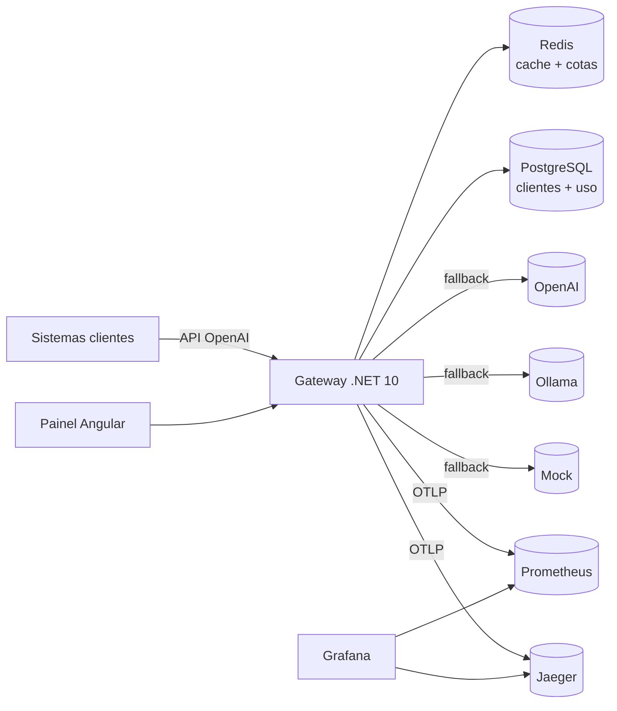

# LLM Gateway


Gateway de LLM compatível com a API da OpenAI. Qualquer sistema passa a usá-lo trocando só a `base_url` e a chave, e ganha:

- **Roteamento com fallback:** um alias de modelo aponta para uma cadeia de provedores (OpenAI → Ollama → mock). Retry e circuit breaker por provedor.
- **Privacidade:** CPF, CNPJ (inclusive o alfanumérico), e-mail, telefone e cartão viram `[CPF_1]`, `[EMAIL_1]`… antes de sair para o provedor, e voltam ao normal na resposta, inclusive em streaming.
- **Governança:** uma chave por sistema, rate limit por minuto e cota mensal de tokens.
- **Custo:** tabela de preços por modelo, custo por requisição e por cliente.
- **Cache:** respostas idênticas servidas do Redis, a custo zero.
- **Observabilidade:** OpenTelemetry → Prometheus + Jaeger → dashboard no Grafana.
- **Painel administrativo** em Angular: clientes e chaves, consumo, requisições, saúde dos provedores e playground.

```python
from openai import OpenAI

client = OpenAI(base_url="http://localhost:8300/v1", api_key="gw_demo_insightql")
reply = client.chat.completions.create(
    model="default",
    messages=[{"role": "user", "content": "Meu CPF é 529.982.247-25, pode confirmar?"}],
)
```

O provedor recebe `Meu CPF é [CPF_1], pode confirmar?`; o seu código recebe a resposta com o CPF de volta.

## Arquitetura



Detalhes em [docs/02-arquitetura.md](docs/02-arquitetura.md).

## Como rodar

Pré-requisito: Docker com Compose v2.

```bash
cp .env.example .env
docker compose up -d --build --wait
```

| Endereço | O quê |
|---|---|
| http://localhost:8300/v1 | API do gateway (compatível com OpenAI) |
| http://localhost:8380 | Painel administrativo |
| http://localhost:8330 | Grafana (dashboard "LLM Gateway" já é a home) |

Sem nenhuma chave paga, os aliases `mock-1`, `mock-resilient` e `default` já funcionam. O `default` tenta OpenAI e Ollama e cai no mock, o que demonstra o fallback.

### Gerar tráfego para o dashboard

```bash
docker compose --profile load run --rm k6
```

O script simula os quatro projetos do portfólio por 3 minutos:
- prompts com dados pessoais;
- streaming;
- um provedor instável (`mock-resilient`, com 35% de falhas);
- um cliente `sandbox` com limite de 5 requisições por minuto, para gerar 429.

### Usar provedores reais

No `.env`, preencha `OPENAI_API_KEY`. Para modelo local:

```bash
docker compose --profile local-llm up -d
docker compose --profile local-llm run --rm ollama-pull
```

### Chaves de demonstração

| Cliente | Chave | Limite |
|---|---|---|
| InsightQL | `gw_demo_insightql` | 120 req/min |
| DocFlow | `gw_demo_docflow` | 120 req/min |
| ZapAgent | `gw_demo_zapagent` | 120 req/min |
| FarmaRadar | `gw_demo_farmaradar` | 120 req/min |
| Playground | `gw_demo_playground` | 30 req/min |
| Sandbox | `gw_demo_sandbox` | 5 req/min |

As chaves vêm do `.env`; troque-as fora do ambiente local. Novos clientes são criados pelo painel e recebem uma chave aleatória exibida uma única vez.

## Cabeçalhos úteis

| Requisição | Efeito |
|---|---|
| `x-gateway-pii-rehydrate: false` | Devolve a resposta com os placeholders, sem restaurar os dados |
| `x-gateway-cache: bypass` | Ignora o cache |

| Resposta | Conteúdo |
|---|---|
| `x-gateway-provider` / `x-gateway-model` | Quem respondeu de fato (`cache` em cache hit) |
| `x-gateway-fallbacks` | Quantos destinos foram pulados |
| `x-gateway-cost-usd` / `x-gateway-tokens` | Custo e tokens da chamada |
| `x-request-id` | Correlação com o log e com o trace |

## Testes

```bash
docker compose --profile test run --rm --build gateway-test
docker compose --profile test run --rm --build admin-test
docker compose --profile smoke run --rm smoke
```

## Estrutura

```
llm-gateway/
├── gateway/                 .NET 10 (Core, Infrastructure, Api, Tests)
├── admin/                   Angular 22 + nginx
├── observability/           Prometheus, datasources e dashboard do Grafana
├── load/k6/                 smoke test e teste de carga
├── docs/                    ideia, arquitetura, execução, pipeline e ADRs
├── docker-compose.yml
└── .github/workflows/ci.yml
```

## Documentação

| Documento | Conteúdo |
|---|---|
| [01 - Ideia](docs/01-ideia.md) | Problema, escopo e requisitos |
| [02 - Arquitetura](docs/02-arquitetura.md) | C4, pipeline da requisição, camadas, dados e métricas |
| [03 - Execução](docs/03-execucao.md) | Como foi construído e os problemas encontrados |
| [04 - Pipeline](docs/04-pipeline.md) | Guia da pipeline de CI/CD |
| [ADRs](docs/adr) | Decisões de arquitetura |
