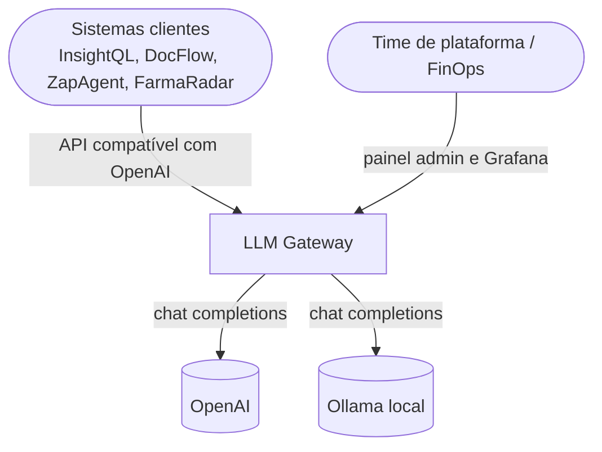
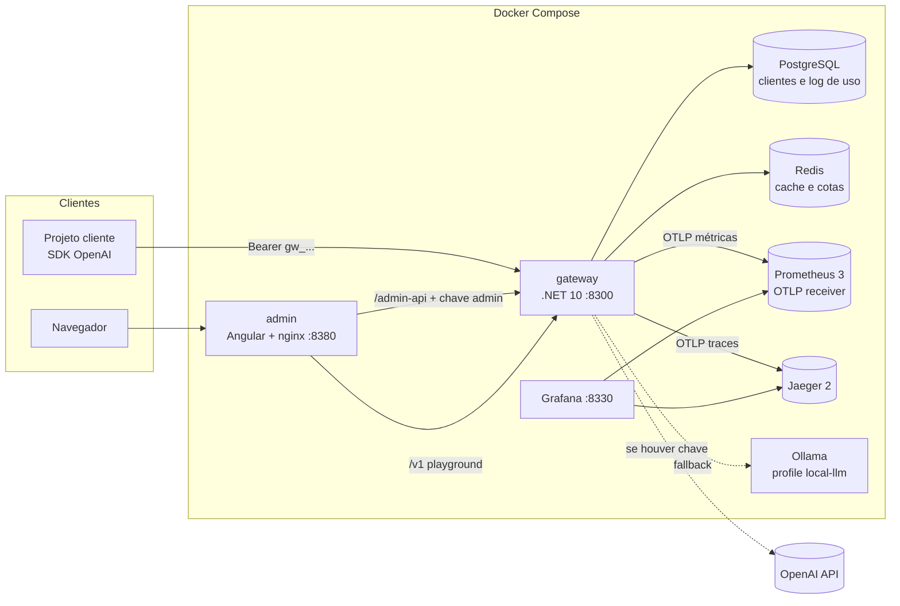
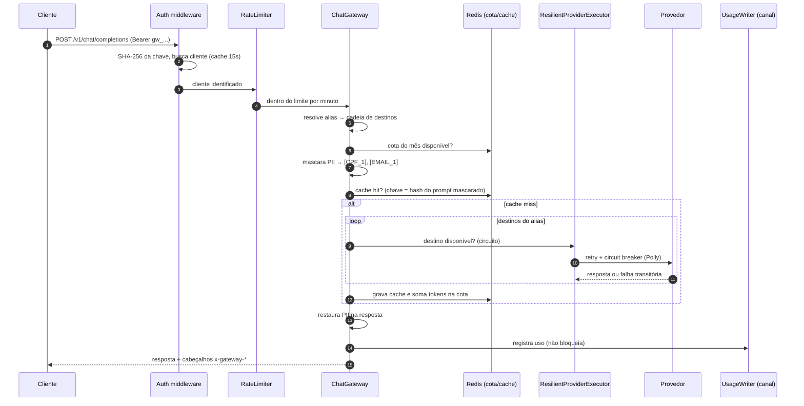
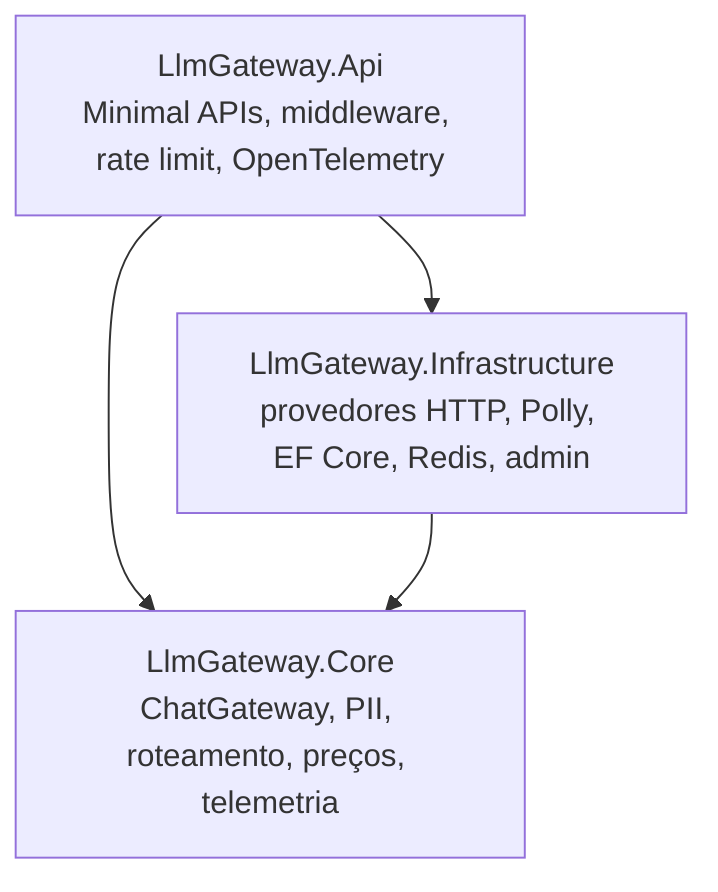
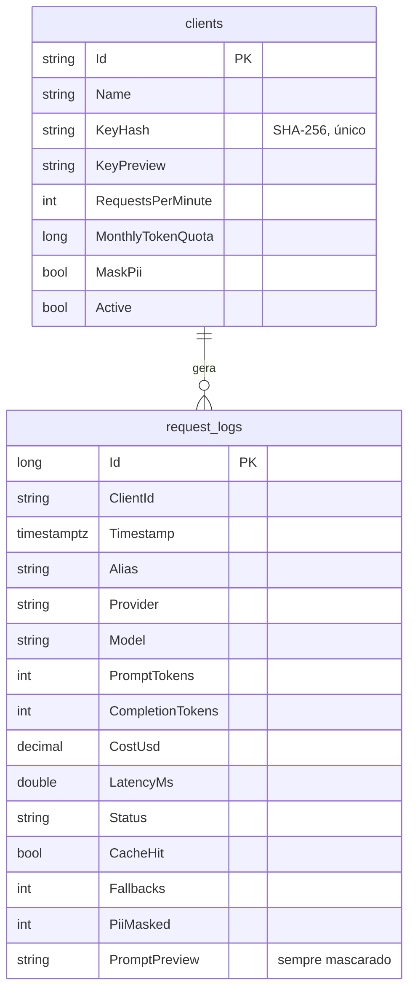

# 02 - Arquitetura

## Contexto (C4 nível 1)

## Containers (C4 nível 2)

| Container | Responsabilidade |
|---|---|
| **gateway** | Autenticação, rate limit, cota, PII, cache, roteamento com fallback, custo, telemetria e API admin |
| **admin** | Painel Angular servido por nginx; injeta a chave admin no proxy de `/admin-api` |
| **postgres** | Clientes (hash da chave, limites) e log de requisições para o painel |
| **redis** | Cache de respostas e contador de cota mensal por cliente |
| **prometheus / jaeger / grafana** | Métricas, traces e dashboards provisionados por arquivo |

## Pipeline de uma requisição

Pontos importantes:

- **Passo 2:** o banco guarda só o hash da chave ([ADR 0005](adr/0005-chaves-por-cliente-com-hash.md)).
- **Passo 7:** o mascaramento acontece **antes** do cache. Por isso a chave de cache nunca contém dado pessoal, e perguntas iguais de pessoas diferentes compartilham a mesma entrada ([ADR 0002](adr/0002-mascaramento-de-pii-reversivel.md)).
- **Passos 9 a 11:** retry e circuit breaker são por provedor; o fallback é por alias ([ADR 0003](adr/0003-resiliencia-retry-circuit-breaker-fallback.md)).
- **Passo 14:** a gravação no PostgreSQL acontece fora do caminho da requisição, por um `Channel` com escrita em lote. Se o banco ficar lento, o cliente não sente.

## Streaming

O mesmo pipeline vale para `stream: true`, com três cuidados:

1. O gateway sempre pede `stream_options.include_usage` ao provedor, para contabilizar tokens. Se o cliente não pediu, o bloco final de uso é removido antes de chegar a ele.
2. A restauração de PII usa um buffer que segura só o trecho que pode ser um placeholder incompleto. O resto é repassado na hora.
3. O fallback entre destinos só acontece antes do primeiro byte. Uma falha no meio do stream vira um evento de erro no formato da OpenAI.

## Camadas (Clean Architecture)

| Projeto | Conteúdo | Depende de |
|---|---|---|
| **Core** | Caso de uso `ChatGateway`, `PiiMasker`, `StreamRehydration`, `ModelCatalog`, `PriceTable`, portas (`IProviderExecutor`, `IResponseCache`, `IQuotaStore`, `IUsageSink`) | Só a BCL do .NET |
| **Infrastructure** | `MockChatProvider`, `OpenAiCompatibleProvider`, `ResilientProviderExecutor` (Polly), `RedisResponseCache`, `RedisQuotaStore`, `GatewayDbContext`, `UsageWriter`, `AdminService` | Core, EF Core/Npgsql, StackExchange.Redis, Polly |
| **Api** | `Program`, endpoints `/v1` e `/admin`, autenticação, rate limiter, configuração de OpenTelemetry | Core, Infrastructure |

O Core não conhece HTTP, banco nem Polly. É por isso que 70% dos testes rodam sem rede, com provedores e stores falsos.

## Modelo de dados

## Métricas expostas

| Métrica (como aparece no Prometheus) | Labels | Uso |
|---|---|---|
| `llm_gateway_requests_total` | client, model, provider, status, cache, stream | Volume, erros, cache hit |
| `llm_gateway_tokens_total` | client, provider, model, type | Consumo de entrada e saída |
| `llm_gateway_cost_usd_total` | client, provider, model | Custo por cliente |
| `llm_gateway_request_duration_seconds` | client, model, provider, status, cache, stream | Latência p50/p95 |
| `llm_gateway_fallbacks_total` | from_provider, reason | Instabilidade de provedores |
| `llm_gateway_pii_masked_total` | type | Volume de dados pessoais protegidos |
| `llm_gateway_circuit_state` | provider | 0 fechado, 1 meio aberto, 2 aberto |

## Decisões

| ADR | Decisão |
|---|---|
| [0001](adr/0001-pipeline-proprio-em-vez-de-yarp.md) | Pipeline próprio em vez de YARP para o tráfego de chat |
| [0002](adr/0002-mascaramento-de-pii-reversivel.md) | Mascaramento de PII reversível por requisição |
| [0003](adr/0003-resiliencia-retry-circuit-breaker-fallback.md) | Retry e circuit breaker por provedor, fallback por modelo |
| [0004](adr/0004-opentelemetry-direto-no-prometheus-e-jaeger.md) | OTLP direto para Prometheus e Jaeger, sem Collector |
| [0005](adr/0005-chaves-por-cliente-com-hash.md) | Uma chave por cliente, armazenada só como hash |
