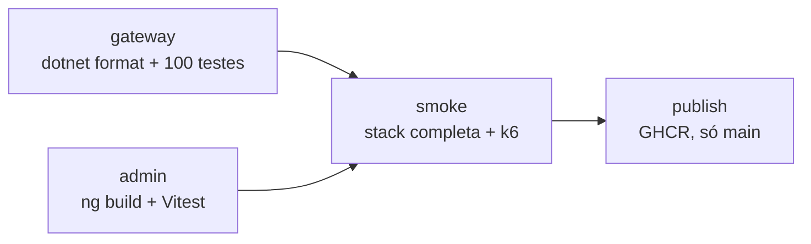

# 04 - Pipeline de CI/CD

Este guia explica a pipeline do LLM Gateway: o que cada etapa garante, como configurar no GitHub e como rodar tudo localmente com os mesmos comandos.

Arquivo: [`.github/workflows/ci.yml`](../.github/workflows/ci.yml)

## Conceitos rápidos

| Termo | O que é |
|---|---|
| **Workflow** | Arquivo YAML em `.github/workflows/` que o GitHub executa quando um evento acontece |
| **Job** | Conjunto de passos numa máquina virtual limpa; jobs rodam em paralelo, a menos que um dependa de outro (`needs`) |
| **Step** | Um comando (`run`) ou uma action pronta (`uses`) |
| **Matrix** | Repete o mesmo job com valores diferentes (aqui, uma vez por imagem) |
| **GHCR** | GitHub Container Registry, onde as imagens Docker ficam publicadas |

## Princípio: o CI roda os mesmos comandos que você

Nenhum job instala .NET ou Node. Tudo é `docker compose`, exatamente como no terminal local. As versões do SDK .NET, do Node e do Angular ficam fixadas nos Dockerfiles. Se passa na sua máquina, passa no CI.

## Fluxo



### 1. `gateway`

```bash
docker compose --profile test run --rm --build gateway-test
```

Constrói o *stage* `test` do Dockerfile do gateway, que roda:

1. `dotnet format --verify-no-changes`: falha se algum arquivo estiver fora do padrão de formatação.
2. `dotnet test`: testes unitários (PII, roteamento, custo, fallback, retry, circuit breaker) e testes de integração com `WebApplicationFactory`.
   - A API sobe de verdade em memória.
   - Postgres e Redis são trocados por implementações em memória.
   - O fluxo HTTP inteiro é testado: autenticação, rate limit, streaming e admin.

Como o build usa `TreatWarningsAsErrors`, qualquer warning do compilador também quebra a pipeline.

### 2. `admin`

```bash
docker compose --profile test run --rm --build admin-test
```

Roda `ng build` (que inclui a checagem estrita de tipos dos templates) e `ng test` com Vitest + jsdom. Não precisa de navegador instalado.

### 3. `smoke`

Sobe a plataforma inteira (`docker compose up -d --build --wait`) e executa o script [`load/k6/smoke.js`](../load/k6/smoke.js) num container do k6. O script verifica, ponta a ponta:

| Verificação | O que prova |
|---|---|
| `/health` e 401 sem chave | Gateway de pé e autenticação ativa |
| Resposta com `[CPF_1]` quando a restauração está desligada | O provedor **não** recebe o CPF |
| Resposta com o CPF original por padrão | A restauração funciona |
| Streaming terminando com `[DONE]` e e-mail restaurado | SSE e restauração em stream |
| Alias `default` respondendo pelo `mock` com fallback ≥ 1 | OpenAI sem chave e Ollama desligado são pulados |
| Segunda chamada igual com `x-gateway-cache: hit` | Cache no Redis |
| Cliente `sandbox` recebendo 429 | Rate limit por cliente |
| `/admin-api/providers` pelo nginx do painel | Proxy do painel com a chave admin |
| Métricas `ok` e `rate_limited` no Prometheus | Exportação OTLP de métricas |
| Dashboard `llm-gateway` no Grafana | Provisionamento por arquivo |
| Serviço `llm-gateway` no Jaeger | Exportação OTLP de traces |

O job usa `thresholds: checks rate==1`: se **qualquer** verificação falhar, o k6 sai com erro e o job quebra. Em caso de falha, o passo seguinte imprime os logs do gateway e do painel.

### 4. `publish` (só na `main`)

Publica as imagens `runtime` do gateway e do painel no GHCR, com duas tags: `latest` e o SHA do commit. A tag do SHA permite implantar ou reverter uma versão exata.

## Configurando no GitHub

### 1. Subir o repositório

```bash
git init
git add .
git commit -m "feat: gateway de LLM com observabilidade"
git branch -M main
git remote add origin https://github.com/guilhermesilva97/llm-gateway.git
git push -u origin main
```

O push já dispara a pipeline. Acompanhe na aba **Actions**.

### 2. Permissão para publicar imagens

Em **Settings → Actions → General → Workflow permissions**, mantenha *Read repository contents and packages permissions*. O job `publish` pede `packages: write` só para ele, seguindo o princípio do menor privilégio.

Depois da primeira publicação, as imagens aparecem em **Packages** no seu perfil. Para deixá-las públicas: abra o pacote, **Package settings → Change visibility → Public**.

### 3. Proteger a `main`

Em **Settings → Branches → Add branch ruleset**:

- exija pull request antes do merge;
- exija os status checks:
  - `Gateway .NET (format + testes)`
  - `Painel Angular (build + testes)`
  - `Smoke test da plataforma completa`

### 4. Secrets

A pipeline **não precisa de nenhum secret**: o smoke test usa o provedor `mock` e chaves de demonstração. Se um dia quiser testar contra a OpenAI no CI, crie o secret `OPENAI_API_KEY` e passe-o como variável de ambiente no passo `docker compose up`. O compose já repassa essa variável ao gateway.

## Reproduzindo localmente

| Job | Comando |
|---|---|
| gateway | `docker compose --profile test run --rm --build gateway-test` |
| admin | `docker compose --profile test run --rm --build admin-test` |
| smoke | `docker compose up -d --build --wait` e depois `docker compose --profile smoke run --rm smoke` |
| limpar | `docker compose --profile smoke --profile test down -v` |

Para validar o YAML do workflow antes do push:

```bash
docker run --rm -v "$(pwd):/repo" -w /repo rhysd/actionlint:latest .github/workflows/ci.yml
```

## Problemas comuns

| Sintoma | Causa provável | Solução |
|---|---|---|
| `dotnet format` falha | Espaçamento ou ordem de `using` fora do padrão | `docker run --rm -v "$(pwd)/gateway:/src" -w /src mcr.microsoft.com/dotnet/sdk:10.0 dotnet format LlmGateway.slnx` |
| `npm ci` falha no admin | `package-lock.json` desatualizado | `docker run --rm -v "$(pwd)/admin:/app" -w /app node:22-alpine npm install --package-lock-only` |
| Smoke falha em "métricas no Prometheus" | Prometheus sem `--web.enable-otlp-receiver` ou URL errada | Conferir `Telemetry__MetricsEndpoint` no compose |
| Smoke falha em "traces no Jaeger" | Exportação de traces ainda não ocorreu | O script espera até 60 s; olhe o log do gateway |
| `publish` com `denied` | Permissão de pacotes | Revisar o passo 2 |
| Smoke falha no Grafana com *connection refused* | Grafana ainda migrando o banco interno | O compose já espera o healthcheck; se mudou o compose, mantenha `grafana: service_healthy` |
| No Git Bash (Windows), k6 não acha `/scripts/load.js` | O MSYS converte caminhos que começam com `/` | Prefixe o comando com `MSYS_NO_PATHCONV=1` |

## Como estender

- **Deploy:** um job `deploy` com `needs: [publish]` que atualize um Azure Container Apps ou AWS ECS com a imagem `:${{ github.sha }}`.
- **Teste de carga com limite de latência:** rodar `load/k6/load.js` com `thresholds` de p95 e falhar se a latência do gateway (descontado o provedor mock) piorar.
- **Segurança das imagens:** `aquasecurity/trivy-action` antes do `publish`.
